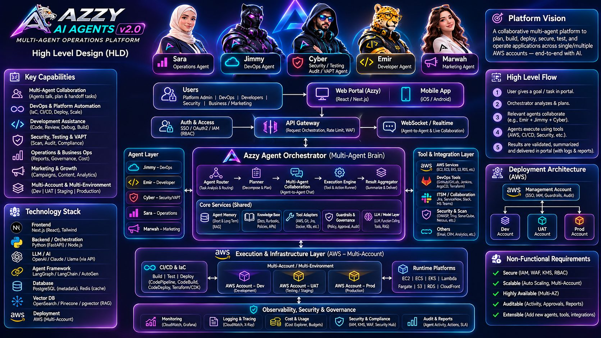

<p align="center">
  
</p>

# AZZY AI AGENTS v2.0

**Enterprise multi-agent AI operations platform — self-hosted, one VM, six containers.**

Created by Shahrukh Khan

Five specialised agents and an orchestrator ("Azzy Orchestrator") share a persistent office: you talk to them individually, hand them multi-step workflows, watch them hand work to each other on a live collaboration graph, and approve anything risky before it runs. Every action goes through a policy engine, an allowlisted tool gateway and an audit log. In **DEMO mode (default)** the LLM is a deterministic stub and every integration returns labelled simulated data, so the full system runs end-to-end with zero cloud keys. `DEMO=0` switches to Bedrock / Anthropic / OpenAI and real AWS, SSH, GitHub, Slack, Gmail and Zendesk adapters.

| Agent | Role |
|---|---|
| **Jimmy** | DevOps Agent |
| **Emir** | Developer Agent |
| **Cyber** | Security / Testing / Audit / VAPT Agent |
| **Sara** | Operations Agent |
| **Marwah** | Marketing Agent |

---

## Contents

1. [Architecture](#architecture)
2. [Sizing](#sizing)
3. [Install on your own VM (recommended)](#install-on-your-own-vm-recommended)
4. [Local install (laptop / DEMO)](#local-install-laptop--demo)
5. [Optional: provision a fresh EC2 with Terraform](#optional-provision-a-fresh-ec2-with-terraform)
6. [Environment configuration](#environment-configuration)
7. [AI API configuration](#ai-api-configuration)
8. [AWS account onboarding](#aws-account-onboarding)
9. [Tailscale configuration (private servers)](#tailscale-configuration-private-servers)
10. [Database migrations (Alembic)](#database-migrations-alembic)
11. [Demo scenarios](#demo-scenarios)
12. [Users, roles and demo credentials](#users-roles-and-demo-credentials)
13. [Running tests](#running-tests)
14. [Security requirements](#security-requirements)
15. [Operations](#operations)
16. [Production deployment path](#production-deployment-path)
17. [Limitations & risks](#limitations--risks)
18. [Troubleshooting](#troubleshooting)
19. [Repository layout](#repository-layout)

---

## Architecture



```
                       Internet (80/443 only)
                              │
                   ┌──────────▼──────────┐
                   │ nginx 1.27           │  TLS (certbot), gzip, CSP/HSTS, WS upgrade,
                   │                      │  /metrics NOT proxied
                   └──┬───────────────┬───┘
     / /app/* /_next  │               │ /api/*  /api/ws  /healthz
            ┌─────────▼───┐     ┌─────▼──────────────────┐
            │ web          │     │ api                    │  FastAPI · JWT cookie + CSRF header
            │ Next.js 15   │────▶│ uvicorn :8000          │  RBAC · policy engine · WS fan-out
            │ R3F office   │     │ Alembic migrations     │  Azzy Orchestrator (typed, own code)
            └──────────────┘     └───┬────────────────┬───┘
                                     │                │
                        ┌────────────▼───┐    ┌───────▼──────────────┐
                        │ redis 7        │    │ postgres 16 + pgvector│
                        │ azzy:events    │    │ users · tasks · msgs  │
                        │ azzy:tasks     │    │ approvals · audit     │
                        │ azzy:approvals │    │ knowledge · memories  │
                        │ cancel flags   │    │ deployments · accounts│
                        └────────────▲───┘    └───────▲──────────────┘
                                     │                │
                                 ┌───┴────────────────┴───┐
                                 │ worker                 │  agent loops · chat · workflows
                                 │ python -m azzy.worker  │  bounded delegation (depth 3, 60 msgs)
                                 └───────────┬────────────┘
                                             │ allowlisted tools only (no shell)
      ┌───────────────────────┬──────────────┼──────────────────┬──────────────────────┐
      ▼                       ▼              ▼                  ▼                      ▼
 AWS accounts            Private VPSes    Code & CI        Comms & tickets        LLM gateway
 STS AssumeRole +        Tailscale SSH →  GitHub/GitLab/   Slack · Gmail ·        Bedrock (IAM role)
 ExternalId              azzy-deploy@host Jenkins          Calendar · Zendesk     Anthropic/OpenAI
 ReadOnly/Audit/Deploy   azzy-action      (branch/PR only)                        fallback
```

Every state change is an event on the `azzy:events` Redis stream; the API fans it out over `/api/ws` and the office, collaboration graph, boards and dashboards animate from those events. The orchestrator is our own typed state machine (durable task rows + Redis queues), not LangGraph.

## Sizing

| | Minimum (DEMO) | Recommended (real mode) |
|---|---|---|
| vCPU / RAM | 2 vCPU / 8 GB | **4 vCPU / 16 GB** (m7i.xlarge; r7i.large = 2 vCPU / 16 GB also works) |
| Disk | 40 GB | **120 GB gp3** |
| OS | Ubuntu 22.04 / 24.04 | Ubuntu 24.04 LTS |

Exactly six containers (nginx, web, api, worker, postgres, redis). Expected footprint: **≈ 2.5–3 GB RSS idle, 4–5 GB under load, images ≈ 3–4 GB on disk.** Compose hard `mem_limit`s (nginx 128 MB, web 768 MB, api 1 GB, worker 1.5 GB, postgres 2 GB, redis 640 MB) and `cpus` caps (0.5 / 1 / 1.5 / 2 / 1.5 / 0.5) stop any one container from starving the box. Postgres is tuned small (`shared_buffers=512MB`, `work_mem=16MB`, `max_connections=60`), Redis is capped at 512 MB with `noeviction` (streams must never be dropped), the Next.js runner has `NODE_OPTIONS=--max-old-space-size=512`, and uvicorn runs one worker (`UVICORN_WORKERS=1`). `install-docker.sh` / `bootstrap.sh` create a 2 GB swapfile as a safety net. No Prometheus, Grafana or OpenTelemetry collector containers are bundled; the API exposes a Prometheus text endpoint on the internal network (see [Operations](#operations)).

---

## Install on your own VM (recommended)

You have a VM (EC2 or any cloud) with a public IP and a domain. ~15 minutes.

### 1. Prepare the box

```bash
# as a sudo-capable user on Ubuntu 22.04/24.04 (Debian 12 and Amazon Linux 2023 also work)
sudo mkdir -p /opt/azzy-ai-agents && sudo chown "$USER" /opt/azzy-ai-agents
# clone … or unzip the release archive into that folder
git clone https://github.com/<you>/azzy-ai-agents.git /opt/azzy-ai-agents
cd /opt/azzy-ai-agents
sudo bash infra/scripts/install-docker.sh      # docker-ce + compose plugin, docker group, 2 GB swap (idempotent)
newgrp docker                                   # or log out / in once
```

Firewall / security group: allow inbound **80 and 443 only**. No public SSH is needed (use Tailscale or your cloud's session manager); if you must, restrict 22 to your IP.

### 2. Configure

```bash
cp infra/.env.example infra/.env
nano infra/.env
```

Change at least:

```ini
OWNER_EMAIL=you@yourdomain.com          # the admin login
OWNER_PASSWORD=<a strong password>
JWT_SECRET=<openssl rand -hex 32>
WEBHOOK_SECRET=<openssl rand -hex 32>
PUBLIC_BASE_URL=https://azzy.yourdomain.com
```

Keep `DEMO=1` for the first boot — it needs no cloud credentials. See [Environment configuration](#environment-configuration) for everything else.

### 3. Start

```bash
docker compose -f infra/docker-compose.yml up -d --build     # first build ≈ 5–8 min
docker compose -f infra/docker-compose.yml ps                 # all six "healthy"
curl -s http://localhost/healthz
```

Open `http://<vm-public-ip>` → **Login** → the `OWNER_EMAIL` / `OWNER_PASSWORD` you set. You are `admin`.

### 4. Map the domain and enable HTTPS

1. DNS: create an **A record** `azzy.yourdomain.com → <vm public IP>` (and an AAAA record if the VM has IPv6). Wait until `dig +short azzy.yourdomain.com` returns the IP (minutes to an hour depending on your DNS provider).
2. Run:
   ```bash
   sudo bash infra/scripts/enable_tls.sh azzy.yourdomain.com you@yourdomain.com
   ```
   What it does: brings nginx up if needed → runs certbot in a throw-away container with the **webroot** http-01 challenge, served through the `infra/nginx/www` volume that nginx already mounts at `/.well-known/acme-challenge/` → writes the certificate to `infra/nginx/certs/live/<domain>/` → renders `infra/nginx/templates/azzy-tls.conf.tmpl` into `conf.d/azzy-tls.conf` (port 443, HSTS, TLS 1.2/1.3) and turns port 80 into ACME + a 301 redirect → `nginx -t` and reload → sets `PUBLIC_BASE_URL=https://<domain>` in `infra/.env` → installs `/etc/cron.d/azzy-renew-tls` (twice daily `certbot renew` + nginx reload).
3. Verify:
   ```bash
   curl -I https://azzy.yourdomain.com            # HTTP/2 200, strict-transport-security header
   curl -I http://azzy.yourdomain.com             # 301 → https
   docker compose -f infra/docker-compose.yml up -d --force-recreate api worker   # pick up PUBLIC_BASE_URL (cookies become Secure)
   ```
4. If DNS was not ready, certbot fails with "DNS problem" / "Invalid response" and **nothing is changed** (the HTTP config stays). Wait for DNS and re-run the same command. Add `--staging` as a third argument to rehearse without hitting Let's Encrypt rate limits (5 failures/hour).

### 5. Start on boot

```bash
sudo cp infra/scripts/azzy.service /etc/systemd/system/azzy.service   # edit WorkingDirectory if not /opt/azzy-ai-agents
sudo systemctl daemon-reload && sudo systemctl enable --now azzy
systemctl status azzy
```

### 6. Updating

- git users: `make update` (= `bash infra/scripts/deploy.sh`: `git pull` → `docker compose up -d --build` → wait for `/healthz` → prune old images). Migrations run automatically when the api container starts.
- zip users: unzip the new version **over** the folder (keep `infra/.env`, `infra/nginx/certs`), then `bash infra/scripts/deploy.sh` or simply `docker compose -f infra/docker-compose.yml up -d --build`.

---

## Local install (laptop / DEMO)

Docker Desktop or Docker Engine 24+ with the compose plugin, 8 GB RAM free.

```bash
cp infra/.env.example infra/.env
docker compose -f infra/docker-compose.yml up -d --build
```

Open **http://localhost** and log in with `OWNER_EMAIL` / `OWNER_PASSWORD` from `infra/.env` (`owner@azzy.local` / `change-me-now` in the example file — change them). `make up`, `make logs`, `make ps`, `make down`, `make clean` (destroys volumes) wrap the compose commands; `make help` lists all targets.

For frontend/back-end development without Docker, see `apps/web/README.md` and `apps/api/README.md` (`next dev` proxies `/api` to `API_INTERNAL_URL`).

---

## Optional: provision a fresh EC2 with Terraform

`infra/terraform` creates: one Ubuntu 24.04 instance (default **m7i.xlarge**, 4 vCPU / 16 GB; `r7i.large` or `m7i.large` are cheaper alternatives), 120 GB encrypted gp3 root, Elastic IP, security group (80/443 in, optional `admin_cidr` on 22, UDP 41641 for Tailscale), an instance role (Bedrock invoke, Secrets Manager `azzy/*`, S3 backups bucket, `sts:AssumeRole` on `AzzyReadOnlyRole|AzzyAuditRole|AzzyDeploymentRole`, SSM core, CloudWatch Logs), a private versioned SSE backups bucket with 30-day lifecycle, and two Secrets Manager secrets (`azzy/env`, `azzy/tailscale`) with placeholder values Terraform never overwrites.

```bash
cd infra/terraform
cp terraform.tfvars.example terraform.tfvars   # repo_url, aws_region, instance_type …
terraform init && terraform apply
```

Then put the real values into Secrets Manager (bootstrap reads them on first boot):

```bash
cp infra/.env.example /tmp/azzy.env && $EDITOR /tmp/azzy.env       # same edits as the VM path + BACKUP_BUCKET=<output backup_bucket>
aws secretsmanager put-secret-value --secret-id azzy/env --secret-string file:///tmp/azzy.env
aws secretsmanager put-secret-value --secret-id azzy/tailscale --secret-string '{"authkey":"tskey-auth-…"}'   # reusable, pre-authorized, tag:azzy
shred -u /tmp/azzy.env
```

`infra/scripts/bootstrap.sh` (user-data) installs Docker/Compose, AWS CLI and Tailscale, creates swap, joins the tailnet (`--ssh --advertise-tags=tag:azzy`), clones the repo to `/opt/azzy-ai-agents`, writes `azzy/env` → `infra/.env`, runs `docker compose up -d --build`, installs `azzy.service` and the 03:00 backup cron. Log: `/var/log/azzy-bootstrap.log`. If you filled the secrets after the first boot, re-run it by hand (`sudo bash /opt/azzy-ai-agents/infra/scripts/bootstrap.sh`, idempotent). Finish with the same `enable_tls.sh` step as above.

CI deploys (optional): on pushes to `main` the `deploy` job in `.github/workflows/ci.yml` assumes `secrets.AWS_ROLE_TO_ASSUME` via OIDC and runs `infra/scripts/deploy.sh` on the instance through SSM (`vars.EC2_INSTANCE_ID`, `vars.AWS_REGION`). Unset = job logs "not configured" and passes.

---

## Environment configuration

`infra/.env` (never committed; on EC2 it is the `azzy/env` secret). Full list with comments in `infra/.env.example`.

| Group | Variables | Notes |
|---|---|---|
| Mode | `DEMO`, `NEXT_PUBLIC_DEMO` | `1` = stub LLM + simulated tools (labelled). Keep both equal. |
| Admin | `OWNER_EMAIL`, `OWNER_PASSWORD` | Seeded as the `admin` user at startup. Re-seeding only updates the password if the env value changed and the user never changed it in-app. |
| Auth | `JWT_SECRET`, `LOGIN_RATE_LIMIT_PER_MIN` (10), `OIDC_*` (reserved, **not implemented**) | JWT HS256, 7-day cookie `azzy_session`. MFA secrets are encrypted with a key derived from `JWT_SECRET` — rotating it invalidates sessions *and* MFA enrolments (see RUNBOOKS). |
| URLs | `PUBLIC_BASE_URL`, `API_INTERNAL_URL` | https base URL turns on the `Secure` cookie flag. |
| Data | `POSTGRES_PASSWORD`, `DATABASE_URL`, `REDIS_URL` | Keep the password consistent in both. |
| Agents | `AGENTS_DIR`, `DAILY_BUDGET_USD`, `KNOWLEDGE_DIR`, `KNOWLEDGE_RETENTION_DAYS` (365), `MEMORY_RETENTION_DAYS` (180) | Per-agent budgets/models are in `packages/agents/*.yaml`. A daily routine purges expired knowledge/memories and audits it. |
| LLM | `AWS_REGION`, `BEDROCK_MODEL`, `EMBEDDINGS_MODEL`, `ANTHROPIC_API_KEY`, `OPENAI_API_KEY` | See next section. |
| Integrations | `SLACK_WEBHOOK_URL`, `GITHUB_TOKEN`, `GITLAB_TOKEN`, `JENKINS_URL`/`JENKINS_TOKEN`, `GMAIL_CREDENTIALS_JSON`, `ZENDESK_*`, `AUTHORIZED_TARGETS`, `WEBHOOK_SECRET` | `/app/integrations` shows what is configured and lets you test each one. |
| Runtime | `UVICORN_WORKERS` (1) | |
| Host-only | `TAILSCALE_AUTHKEY`, `BACKUP_BUCKET` | Read by scripts, not by containers. |

After editing: `make restart` (recreates api, worker, web).

---

## AI API configuration

In DEMO nothing here is needed. For `DEMO=0`:

**Bedrock (primary).** The api/worker authenticate with the instance role (no keys) — or with the usual `AWS_ACCESS_KEY_ID`/`AWS_SECRET_ACCESS_KEY` env if you run elsewhere. In the Bedrock console → *Model access* in `AWS_REGION`, enable the model you set in `BEDROCK_MODEL` (LiteLLM id, keep the `bedrock/` prefix, e.g. `bedrock/anthropic.claude-3-5-sonnet-20241022-v2:0`; for cross-region profiles use `bedrock/apac.anthropic…`). The Terraform instance policy allows `anthropic.*` foundation models and inference profiles; widen `bedrock_model_arns` if you pick another vendor. Also enable **`amazon.titan-embed-text-v2:0`** (or change `EMBEDDINGS_MODEL`) — the knowledge base requests 384-dimensional embeddings (`dimensions=384`) to match the `vector(384)` columns; switching to a model with a different fixed size needs a migration.

**Fallbacks.** `ANTHROPIC_API_KEY` and/or `OPENAI_API_KEY`: used when Bedrock is unavailable or returns an error, in that order. Each agent's `budgets.daily_usd` and `max_tokens_per_task` apply regardless of provider; `DAILY_BUDGET_USD` is the global cap. When a cap is hit the agent stops taking LLM turns and the task goes to `needs_human`.

`/app/integrations` → **Test** on `bedrock`, `anthropic`, `openai` performs a one-token real call and reports the result (simulated and labelled in DEMO).

---

## AWS account onboarding

Agents reach client/workload accounts only through **STS AssumeRole with an ExternalId**. Three scopes, three role names; one CloudFormation template (`infra/cloudformation/azzy-agent-role.yaml`, parameter `Scope`):

| Scope | Default role name | Grants | Used by |
|---|---|---|---|
| `ReadOnly` | **AzzyReadOnlyRole** | describe/list on EC2, ECS, ECR, EKS, Lambda, RDS, ElastiCache, S3 bucket metadata, CloudFront, WAF, Route 53, CloudWatch + Logs read, Cost Explorer | Jimmy inventory & diagnostics, Sara cost/KPI |
| `Audit` | **AzzyAuditRole** | ReadOnly + `iam:GetAccountAuthorizationDetails`, `iam:Generate/GetCredentialReport`, `config:Describe*`, `securityhub:Get*`, `guardduty:Get*/List*`, `access-analyzer:List*`, `cloudtrail:LookupEvents`, KMS metadata, ECR scan findings | Cyber IAM/posture reviews |
| `Deploy` | **AzzyDeploymentRole** | Audit + `ecs:UpdateService`/task definitions, `lambda:UpdateFunctionCode`, ECR push, instance refresh, `ssm:SendCommand` **only** on instances tagged `azzy:managed=true` | Jimmy deploy / rollback (prod always behind approval) |

Every scope carries an explicit **Deny** on IAM writes, Organizations, data-plane reads (S3 objects, Secrets Manager, Parameter Store, DynamoDB, KMS decrypt) and destructive EC2/RDS/EKS/ECS actions. No scope grants AdministratorAccess. The HQ role may only assume those three names (`infra/terraform/iam.tf`).

### In-app wizard (`/app/aws-accounts` → *Add account*, admin only)

1. **Scope** — pick ReadOnly / Audit / Deploy; the wizard generates an ExternalId.
2. **Deploy the role** — copy the snippet it shows (your HQ account id and ExternalId are filled in) and run it in the *client* account:
   ```bash
   aws cloudformation deploy --stack-name azzy-readonly-role \
     --template-file azzy-agent-role.yaml --capabilities CAPABILITY_NAMED_IAM \
     --parameter-overrides AzzyAccountId=<HQ account id> ExternalId=<from wizard> Scope=ReadOnly
   aws cloudformation describe-stacks --stack-name azzy-readonly-role --query "Stacks[0].Outputs"
   ```
   The stack outputs `RoleArn` and `WizardJson` (the exact body the wizard/API expects).
3. **Verify** — paste the role ARN, name, regions and stage (dev / uat / staging / prod) → **Verify**. The API performs `sts:AssumeRole` and a permission probe per scope (`ec2:DescribeInstances`, `ecs:ListClusters`, `logs:DescribeLogGroups`, `ce:GetCostAndUsage`; Audit adds `iam:GetAccountAuthorizationDetails`, `config:DescribeConfigRules`; Deploy simulates `ecs:UpdateService` via `iam:SimulatePrincipalPolicy`) and shows each permission as ✓/✗ with the account status `verified` or `failed` (with the real STS error). The ExternalId is encrypted at rest and never returned.

Afterwards `/app/infrastructure` shows the account's inventory per region (read-only boto3 calls; labelled `demo` in DEMO), and environments can be linked to the account. Organizations: deploy the template as a StackSet to member accounts; each still needs its own ExternalId entered in the wizard.

---

## Tailscale configuration (private servers)

Private VPSes are operated over **Tailscale SSH** as a dedicated user that can only run a fixed menu of commands.

1. **ACL** — paste `infra/tailscale-acl.json` into the Tailscale admin console (*Access controls*). It defines `tag:azzy` (the HQ box) and `tag:servers`, allows `tag:azzy → tag:servers:22` only, and SSH as user `azzy-deploy` only.
2. **HQ** — the HQ joins with an auth key tagged `tag:azzy` (`tailscale up --ssh --advertise-tags=tag:azzy`; bootstrap does this from the `azzy/tailscale` secret). On a hand-installed VM: `curl -fsSL https://tailscale.com/install.sh | sh && sudo tailscale up --ssh --advertise-tags=tag:azzy --authkey tskey-auth-…`.
3. **Each client server** (as root):
   ```bash
   sudo APP_DIR=/srv/myapp bash client-server-setup.sh --tailscale-authkey tskey-auth-…   # key tagged tag:servers
   ```
   Creates user `azzy-deploy`, installs `/usr/local/bin/azzy-action` (`status | restart | logs [svc] | deploy vX.Y.Z | rollback | disk | top`, only Compose commands in `APP_DIR`; `deploy` takes `^v[0-9]+\.[0-9]+\.[0-9]+$` and records the previous version for `rollback`), writes `/etc/sudoers.d/azzy-deploy` (NOPASSWD for that one script), and joins the tailnet with `--ssh --advertise-tags=tag:servers`. Every invocation is appended to `/var/log/azzy-action.log`. Classic OpenSSH instead of Tailscale SSH: pin the HQ key in `~azzy-deploy/.ssh/authorized_keys` with `command="/usr/local/bin/azzy-action",no-port-forwarding,no-agent-forwarding,no-X11-forwarding,no-pty`.
4. **Register** the server in `/app/infrastructure` → *Add environment*: method `tailscale_ssh`, target = Tailscale IP / MagicDNS name, kind `prod` or `staging`, and which medium-risk tools the env may auto-allow. Test from HQ: `tailscale ssh azzy-deploy@<host> azzy-action status`.

AWS Systems Manager is the alternative gateway for EC2 fleets: with `AzzyDeploymentRole`, `ssm:SendCommand` works only on instances tagged `azzy:managed=true` and only with `AWS-RunShellScript`/`AWS-RunPatchBaseline`; the command text comes from the fixed `ssh.safe_action` menu, never from the model.

---

## Database migrations (Alembic)

Schema changes are Alembic migrations in `apps/api/alembic/versions/`; the api container runs `alembic upgrade head` on start (and CI verifies `alembic current` prints the head after `compose up`).

```bash
docker compose -f infra/docker-compose.yml exec api alembic current          # show revision
docker compose -f infra/docker-compose.yml exec api alembic upgrade head     # apply (idempotent)
docker compose -f infra/docker-compose.yml exec api alembic history          # list
docker compose -f infra/docker-compose.yml exec api alembic downgrade -1     # roll back one step (take a backup first)
```

Adding a migration (e.g. `0002`):

```bash
# 1. change the SQLAlchemy models in apps/api/azzy/db/models.py
# 2. autogenerate against the running database
docker compose -f infra/docker-compose.yml exec api alembic revision --autogenerate -m "add deployments.notes"
# 3. the new file lands in apps/api/alembic/versions/0002_add_deployments_notes.py (the container bind-mounts nothing,
#    so copy it out: docker compose cp api:/app/alembic/versions/. apps/api/alembic/versions/) — or run alembic locally
#    with DATABASE_URL pointing at localhost:5432 (expose the port temporarily).
# 4. review the upgrade()/downgrade() bodies (pgvector columns need sa.Column(Vector(384)) imported from pgvector.sqlalchemy)
# 5. apply and commit
docker compose -f infra/docker-compose.yml exec api alembic upgrade head
pytest apps/api -q
```

Never edit an applied migration; add a new one. `make migrate` is a shortcut for `upgrade head`.

---

## Demo scenarios

All five work with `DEMO=1` and no keys. Timings are the demo pacing.

1. **Client B deploy with approval** — in the command bar type `Client B VPS pe v2.3 deploy karo`. Routed to Jimmy and the Client B environment (prod, Tailscale SSH). Jimmy's phases stream at his desk; a prod deploy is *high* risk so an approval appears as a bubble over his desk, on `/app/approvals`, and in Slack when configured. Approve → `ssh.safe_action deploy v2.3.0` runs, a `deployments` row goes `awaiting_approval → running → verifying → succeeded`, the task walks the board to **done**, a memory is written and the cost tiles tick (≈ 15 s after approval).
2. **Call meeting** — `/app/office` → **Call meeting**: all five walk to the central orchestration table, speak in turn, and return; the LED wall shows `meeting`.
3. **Simulate incident** — `/app/monitoring` (or the office) → **Simulate incident**: an incident opens, the office goes to `incident`, the war room runs (Jimmy leads with CloudWatch/ECS, Emir finds root cause, Cyber checks for an attack, Sara drafts the customer update) and Jimmy asks for a **rollback** approval; approve and the incident resolves. Nothing is emailed without you.
4. **ECS workflow** — paste `Investigate my failing ECS deployment, fix the application issue, test it, perform a security assessment, and request approval before deploying`. Kind `workflow`, lead Jimmy, assignees Jimmy → Emir → Cyber → Jimmy → Sara. Watch `/app/collaboration` light up edge by edge (every handoff is a persisted `agent.message`), open the task's *Messages* tab, then approve the prod deployment on `/app/approvals`. ≈ 45 s plus your approval. You can **Cancel** it at any step from the task drawer.
5. **Chat with Jimmy** — `/app/agents/jimmy` → ask *What environments do we have?* He answers from live state (environments, versions, last deployment). Ask *deploy v2.4 to client b* and he turns it into a normal command task and tells you the task id. Cyber quotes the last scans; Sara quotes task counts and KPIs; Marwah drafts campaign copy.

---

## Users, roles and demo credentials

The only credentials that exist are the ones **you** put in `infra/.env` — nothing is hardcoded. `OWNER_EMAIL` / `OWNER_PASSWORD` seed the first `admin`. Create more users under `/app/settings → Users` (admin) or `POST /api/users`.

| Role | Can |
|---|---|
| `admin` | everything: users, environments, AWS accounts, integrations, settings, all approvals |
| `devops` / `developer` / `security` / `operations` / `marketing` | create tasks, chat, call meetings, simulate incidents, upload global knowledge, cancel own tasks and tasks led by their agent, **approve/reject only requests raised by their agent** (`policy.yaml → approval_roles`: Jimmy ← devops, Emir ← developer/devops, Cyber ← security, Sara ← operations, Marwah ← marketing) |
| `readonly` | GET only; every write button is disabled with a tooltip |

Sessions: HS256 JWT in an `HttpOnly; SameSite=Lax` (+`Secure` on https) cookie, 7 days; TOTP MFA per user under *Settings → Profile*; login rate-limited to `LOGIN_RATE_LIMIT_PER_MIN` per IP; every non-GET API call must carry `X-Requested-With: azzy` (CSRF). OIDC/SSO is not implemented in v2.0.

---

## Running tests

```bash
npm install                                  # workspaces: apps/web, packages/events, e2e
npm run typecheck && npm run lint && npm run build
pytest apps/api -q                           # policy, guard, router, costs, events, stub LLM, API
npx playwright install --with-deps chromium  # once
npm run e2e                                  # against E2E_BASE_URL (default http://localhost) — stack must be up
npm run e2e -- --project=mobile              # 390×844 touch project only
make screenshots                             # regenerate e2e/screenshots/{desktop-chromium,mobile}/*.png
```

Playwright suite (`e2e/`): `auth`, `approval-flow`, `pipeline-move`, `meeting`, `incident`, `chat`, `collaboration`, `cancel`, `aws-accounts`, `rbac`, `audit`, `public`, `mobile`, `screenshots`. It logs the admin in once (storage state in `e2e/.auth/`), sends the CSRF header on API calls, and runs in ~6 minutes on two workers. CI (`.github/workflows/ci.yml`) runs web checks, pytest with Postgres/Redis service containers, then the whole e2e suite against a fresh `docker compose up --build`, checks `alembic current` is at head, and uploads the screenshots (always) and the Playwright report (on failure).

Tests that **cannot** run in CI because they need credentials: real Bedrock/Anthropic/OpenAI calls, real `sts:AssumeRole` against a client account, Tailscale SSH to a real server, GitHub/GitLab/Jenkins/Slack/Gmail/Zendesk calls. They are exercised through `/app/integrations → Test` on a configured instance; the demo adapters are what CI covers.

---

## Security requirements

Full design in [`docs/SECURITY.md`](docs/SECURITY.md). The non-negotiables:

- Run behind HTTPS (`enable_tls.sh`), open only 80/443, keep SSH off the internet (Tailscale / SSM).
- Rotate `JWT_SECRET`, `WEBHOOK_SECRET` and `OWNER_PASSWORD` from the example values before exposing the box; enable MFA for every admin.
- Secrets live only in `infra/.env` (mode 600) / Secrets Manager; never in git, images, prompts or Postgres (environments store a `secret_ref`, AWS accounts store an encrypted ExternalId).
- Cross-account access only through the three Azzy roles with ExternalId; never paste root or admin keys anywhere.
- Keep `AUTHORIZED_TARGETS` to hosts you own or are contracted to test; `nuclei`/`zap` refuse everything else.
- Treat the box as a single trust zone: anyone with shell access can read `infra/.env`.

---

## Operations

Runbooks (backup/restore, rotate secrets, upgrade, worker down, disk full, cert renewal) are in [`docs/RUNBOOKS.md`](docs/RUNBOOKS.md).

| Task | How |
|---|---|
| Status | `make ps` · `curl -s http://localhost/healthz` · `/app/monitoring` (system metrics: queue depth, worker heartbeat, WS clients, DB/Redis) |
| Logs | `make logs` / `make logs SERVICE=worker` — structured JSON, json-file driver rotated at 10 MB × 5 |
| Metrics | `docker compose -f infra/docker-compose.yml exec api curl -s localhost:8000/metrics` (Prometheus text). To scrape later, run Prometheus on the compose network (`network: azzy_default`) or on the host with `docker compose … port api 8000`; nginx deliberately returns 404 for `/metrics`. |
| Update | `make update` (git) or unzip + `bash infra/scripts/deploy.sh` (zip) |
| Change env | edit `infra/.env` → `make restart` |
| Backup | nightly 03:00 cron → `/var/backups/azzy/*.sql.gz` (last 7) + `s3://$BACKUP_BUCKET/postgres/`; manual `make backup` |
| Restore | `make restore FILE=<dump>` or `FILE=--latest` |
| Cost caps | `DAILY_BUDGET_USD` (or `/app/settings`), per-agent `budgets.daily_usd`; `/app/reports` and the costs tiles show burn |
| Artifacts | decks/sheets/PDFs in the `artifacts` volume (`/app/reports` → download); uploaded knowledge files in the `knowledge` volume |
| Reboot | `systemctl status azzy` brings the stack back |

---

## Production deployment path

The single-VM compose stack is a **pilot** architecture: no HA, one failure domain. The components were kept stateless/12-factor so they can move piecewise:

| Step | Move | Notes |
|---|---|---|
| 1 | Postgres → **Amazon RDS for PostgreSQL 16** (pgvector supported) | `pg_dump` from `backup.sh` → `pg_restore`; set `DATABASE_URL`; keep `max_connections` modest (one api + one worker). Multi-AZ for HA. |
| 2 | Redis → **ElastiCache for Redis 7** | Streams + pub/sub + `SET NX` locks only; `noeviction` policy; cluster-mode off. `REDIS_URL=rediss://…`. |
| 3 | Artifacts / knowledge volumes → **S3** | `ARTIFACTS_DIR`/`KNOWLEDGE_DIR` behind an S3 adapter (`azzy/paths.py` is the single seam) or EFS as a stop-gap. |
| 4 | api / worker / web images → **ECR**, services → **ECS Fargate** | api 1 vCPU/2 GB (scale 2+), worker 1 vCPU/3 GB (scale by `queue_depth` metric), web 0.5 vCPU/1 GB. Task role = today's instance role. Secrets from Secrets Manager via task definition `secrets`. |
| 5 | nginx → **ALB** (+ ACM cert) → **CloudFront** → **WAF** | ALB target groups: `/api/*`,`/healthz` → api; everything else → web. WebSocket on ALB: idle timeout ≥ 3600 s, sticky not needed (Redis fan-out). CloudFront: cache `/_next/static/*` immutable, forward cookies/headers for `/api/*` and `/app/*`. WAF: AWS managed rule sets + rate rule on `/api/auth/login`. |
| 6 | Auto Scaling + observability | api/worker ECS service auto scaling; Prometheus endpoint → AMP or CloudWatch agent; structured JSON logs → CloudWatch Logs (log group `/azzy/*` already allowed). |

Nothing in the application assumes a single process except the in-memory approval futures, which already round-trip through Redis pub/sub (`azzy:approval:{id}`), so multiple workers are safe.

---

## Limitations & risks

Stated plainly, per the v2 brief:

- **OIDC / SSO is not implemented.** Authentication is local accounts (bcrypt) + TOTP MFA. The `OIDC_*` variables are reserved and ignored.
- **Single-node pilot, no HA.** One VM, one Postgres, one Redis, one worker. A host failure means downtime until restore; see the production path above.
- **LangGraph / OpenAI Agents SDK are not used.** The orchestrator is our own typed state machine (Pydantic contracts, durable task rows, Redis queues, bounded delegation). It is traceable and testable, but it is not a framework you may already know.
- **No Grafana / Prometheus / OpenTelemetry collector bundled.** Only a Prometheus text endpoint (`/metrics`, internal) and `/api/system/metrics`. Dashboards and tracing are on you.
- **Scanners are opt-in.** The default api image is kept light and contains no scanner binaries. Build with `WITH_SCANNERS=1` in `infra/.env` (adds ≈ 600 MB: semgrep, checkov, gitleaks, trivy); nuclei and ZAP are never bundled. `/app/integrations` shows which are actually present, and a missing binary makes the tool return a labelled "not installed" result — never a fake pass. In DEMO mode all scans are simulated and labelled.
- **Real-mode integrations are unverified in CI.** CI runs DEMO adapters only. Bedrock, AssumeRole, Tailscale SSH, GitHub/GitLab/Jenkins, Slack, Gmail/Calendar and Zendesk code paths are exercised manually through the integration tests in the UI.
- **The LLM can be wrong.** Policy, allowlists and approvals bound *what* it can do, not whether its analysis is right. Approvals are decisions you own.
- **Prompt injection is mitigated, not solved.** Tool output is scrubbed and the executor ignores instructions found in data, but a determined adversary controlling logs or repos can still influence the model's *reasoning*; approvals and the fixed tool menu are the real safety boundary.
- **Secrets on the host.** `infra/.env` is readable by root and the docker group. Use Secrets Manager + minimal host access.
- **DEMO data is labelled, not hidden.** Every simulated response carries `demo: true` and the UI shows a DEMO chip; buttons that cannot act in the current mode are disabled with a tooltip.

---

## Troubleshooting

- **Office shows the 2D fallback.** No WebGL (headless, remote desktop, old GPU) or the HDRI CDN (`cdn.jsdelivr.net`, `raw.githack.com`) is blocked by your network/CSP. All controls keep working; the fallback lists agents, statuses and approvals.
- **"Live: reconnecting" and nothing animates.** `/api/ws` is not upgrading. Behind another proxy/CDN enable WebSockets and set idle timeouts ≥ 60 s (nginx here allows 3600 s). The client polls `/api/state` meanwhile.
- **Login loops back to `/login`.** Cookie dropped: you opened `http://` while `PUBLIC_BASE_URL` is `https://` (Secure flag) or vice-versa. Fix the URL / variable, `make restart`.
- **403 on every write from a script.** Add `X-Requested-With: azzy` to non-GET requests.
- **429 on login.** Rate limit (`LOGIN_RATE_LIMIT_PER_MIN`); wait a minute.
- **Bedrock `AccessDeniedException`.** Enable the model in *Bedrock → Model access* in `AWS_REGION`; make sure `BEDROCK_MODEL` is `bedrock/<enabled id or inference profile>`; confirm the box uses the instance role (`aws sts get-caller-identity`); widen `bedrock_model_arns` for non-Anthropic models.
- **AWS account verification `failed`.** Check the stack outputs' `RoleArn`, that the ExternalId you typed equals the stack parameter, that `AzzyAccountId` is the HQ account (`terraform output account_id` or `aws sts get-caller-identity` on the HQ), and that the HQ role is allowed to assume that role name (only the three default names are).
- **`api` unhealthy at first start.** It waits for Postgres and runs migrations; `make logs SERVICE=api`. Usual causes: `POSTGRES_PASSWORD` ≠ password in `DATABASE_URL`, or a failed migration (`alembic current`).
- **Worker shows "down" on `/app/monitoring`.** `docker compose … restart worker`; see RUNBOOKS "Worker down". Tasks in flight resume from their last durable step or fail with a clear result.
- **Certbot fails.** DNS not propagated or port 80 blocked; re-run with `--staging` to debug; `docker compose ps nginx` must be healthy; `infra/nginx/www` must be writable.
- **Out of memory / OOM-killed containers.** Check `docker stats`; the worker has the highest ceiling (1.5 GB). Reduce `WORKER_CONCURRENCY`, keep `UVICORN_WORKERS=1`, confirm swap is on (`swapon --show`).
- **Playwright cannot log in.** `OWNER_EMAIL`/`OWNER_PASSWORD` in your shell must match `infra/.env`; delete `e2e/.auth/owner.json` after changing them.
- **SSM deploy from CI times out.** SSM agent online (`aws ssm describe-instance-information`); the OIDC role needs `ssm:SendCommand` on the instance *and* on `document/AWS-RunShellScript`.

---

## Repository layout

```
apps/api/            FastAPI app + worker (azzy.main, azzy.worker, orchestrator, policy, guard, tools, llm), Alembic
apps/web/            Next.js 15 app: public site, portal (/app/*), 3D office (R3F), PWA
packages/events/     zod event + object schema shared by web and mirrored in api; AGENT_META, BRAND
packages/agents/     jimmy / emir / cyber / sara / marwah .yaml + policy.yaml
assets/brand/        logo
docs/                CONTRACT.md, CONTRACT-v2.md, SECURITY.md, RUNBOOKS.md, hld-v2.jpg
infra/
  docker-compose.yml nginx, web, api, worker, postgres (pgvector), redis — six containers
  .env.example       every variable with safe defaults
  docker/            web.Dockerfile (api Dockerfile lives in apps/api)
  nginx/             conf.d (HTTP + shared locations), templates (TLS, redirect), certs/, www/ (ACME)
  terraform/         optional EC2 + EIP + SG + IAM role + S3 backups + Secrets Manager
  cloudformation/    azzy-agent-role.yaml (AzzyReadOnlyRole / AzzyAuditRole / AzzyDeploymentRole)
  tailscale-acl.json tag:azzy → tag:servers:22, SSH as azzy-deploy
  scripts/           install-docker.sh, azzy.service, enable_tls.sh, deploy.sh, backup.sh, restore.sh,
                     bootstrap.sh (EC2 user-data), client-server-setup.sh
e2e/                 Playwright config, global login, specs, screenshots/
.github/workflows/   ci.yml (web, api, e2e + alembic smoke + screenshots, deploy via SSM)
Makefile             up / down / restart / logs / ps / test / e2e / screenshots / backup / restore / tls / update / migrate
```

---

<p align="center">AZZY AI AGENTS v2.0 · Created by Shahrukh Khan</p>
